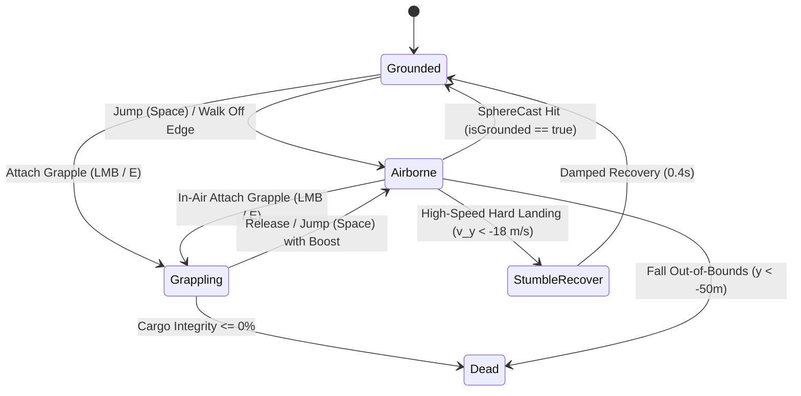

# TECHNICAL SPECIFICATION DOCUMENT: CORE PHYSICS & SYSTEM INTEGRATION
**Project:** The Last Delivery  
**Document Ref:** SDD-ENG-TRK-A-01  
**Module Owner:** Huzaifa Yasin | Roll No: 2023F-BCE-161  
**Role:** Group Leader, Core Physics & System Integration Lead  
**Batch:** 2023f | Department of Computer Engineering, SSUET  
**Supervisor:** Ms. Saba Ahsan  
**Date of Ratification:** 14 November 2026  
**Status:** Approved for Implementation (SDD v1.0)  

---

## 1. System Overview & Architectural Philosophy

This document defines the mathematical, architectural, and procedural specification for the **Core Physics, Player Locomotion, Grappling Mechanics, Integrity Damage Model, and Integration Contracts** of *The Last Delivery*.

### 1.1 Methodology: Spec-Driven Development (SDD)
All engineering implementations must trace directly to a verifiable specification in this document. Any behavior not explicitly permitted in this specification is considered a defect. The development loop follows:

$$\text{Specification} \longrightarrow \text{State Model \& Math} \longrightarrow \text{Strict Implementation} \longrightarrow \text{Acceptance Verification}$$

### 1.2 Coordinate System & Standard Units
* **Engine:** Unity 3D (URP)
* **Coordinate System:** Left-handed, Y-up ($+X = \text{Right}, +Y = \text{Up}, +Z = \text{Forward}$)
* **Units:** SI Standard (Meters $\text{m}$, Seconds $\text{s}$, Kilograms $\text{kg}$, Degrees $^\circ$, Radians $\text{rad}$)

---

## 2. Global Player State Machine



---

## 3. Module 1: 3D Locomotion & Ground Physics

### 3.1 Kinematic Character Model
Locomotion is handled via a `CharacterController` component configured with:
* Height: $2.0\,\text{m}$
* Radius: $0.5\,\text{m}$
* Step Offset: $0.35\,\text{m}$
* Slope Limit: $45.0^\circ$
* Skin Width: $0.08\,\text{m}$

### 3.2 Horizontal Movement Physics
1. **Camera-Relative Vector Translation:**
   Given user input vector $\vec{I} = (h, 0, v)^T$ where $h, v \in [-1, 1]$:
   $$\vec{d}_{\text{cam}} = \text{Normalize}\left( \text{ProjectOnPlane}(\vec{f}_{\text{cam}}, \hat{y}) \cdot v + \text{ProjectOnPlane}(\vec{r}_{\text{cam}}, \hat{y}) \cdot h \right)$$
   Where $\vec{f}_{\text{cam}}$ is camera forward and $\vec{r}_{\text{cam}}$ is camera right.

2. **Rotational Slerp:**
   $$\theta_{\text{target}} = \text{atan2}(d_{x}, d_{z}) \cdot \frac{180^\circ}{\pi}$$
   $$R(t + \Delta t) = \text{Slerp}\left( R(t), \text{Quaternion.Euler}(0, \theta_{\text{target}}, 0), \omega_{\text{rot}} \cdot \Delta t \right)$$
   * Rotational speed $\omega_{\text{rot}} = 14.0\,\text{rad/s}$.

3. **Speed Constants:**
   * Ground Base Speed ($v_{\text{ground}}$): $8.5\,\text{m/s}$
   * Air Steering Authority ($\alpha_{\text{air}}$): $0.50$ (50% control in air)
   * Effective Horizontal Speed:
     $$v_{\text{horiz}} = \begin{cases} v_{\text{ground}} & \text{if } \text{IsGrounded} \\ v_{\text{ground}} \cdot \alpha_{\text{air}} & \text{if } \text{Airborne} \end{cases}$$

### 3.3 Vertical Dynamics & Gravity
1. **Jump Initial Velocity ($v_{0, y}$):**
   Calculated using energy conservation equation:
   $$v_{0, y} = \sqrt{2 \cdot h_{\text{jump}} \cdot |g|}$$
   * Target jump height $h_{\text{jump}} = 2.2\,\text{m}$
   * Gravity $g = -22.0\,\text{m/s}^2$
   * Yields: $v_{0, y} \approx 9.838\,\text{m/s}$

2. **Grounded Downforce:**
   To guarantee continuous snapping on downward slopes and stairs, when grounded and vertical velocity is non-positive:
   $$v_y = v_{\text{grounded\_snap}} = -3.0\,\text{m/s}$$

3. **Terminal Velocity Cap:**
   $$v_{y,\text{terminal}} = -45.0\,\text{m/s}$$

### 3.4 Ground Snapping & Detection Algorithm
To eliminate jitter caused by standard `CharacterController.isGrounded` ray drops on edges:
* **Detection Geometry:** `SphereCast` originating at bottom cap:
  $$\vec{P}_{\text{origin}} = \vec{P}_{\text{player}} + \vec{c}_{\text{center}} - \left(\frac{H}{2} - R\right)\hat{y}$$
  $$\text{Ray Length } l = R \cdot 0.95 + \delta_{\text{ground\_offset}} \quad (\delta_{\text{ground\_offset}} = 0.15\,\text{m})$$
* **Validation:** Valid hit if surface normal $\vec{n}_{\text{surf}}$ satisfies:
  $$\vec{n}_{\text{surf}} \cdot \hat{y} \ge \cos(45^\circ) \approx 0.707$$

---

## 4. Module 2: Grapple Hook & Pendulum Swing Mechanics

### 4.1 Anchor Acquisition & Targeting
The targeting system continuously searches for candidate points using a conical volume check:
1. **Candidate Pool:** Overlap sphere of radius $R_{\text{max}} = 35.0\,\text{m}$ filtered by Tag `"GrapplePoint"`.
2. **Line of Sight (LOS) Clearance:**
   Raycast from player chest $(P_{\text{player}} + 1.2\hat{y})$ to anchor center $P_{\text{anchor}}$:
   $$\text{HitCollider} == \text{AnchorCollider} \quad \text{on LayerMask } M_{\text{obstacles}}$$
3. **Selection Metric (Best Anchor Scoring):**
   $$S = w_d \cdot \left(1 - \frac{d}{R_{\text{max}}}\right) + w_\theta \cdot \cos(\theta)$$
   Where $d = \|\vec{P}_{\text{anchor}} - \vec{P}_{\text{player}}\|$, $\theta$ is angle between camera forward and anchor vector, with weights $w_d = 0.35, w_\theta = 0.65$.

### 4.2 Dynamic Swing Physics Model
When connected, the player is modeled as a damped spherical pendulum with variable cable length $L(t)$.

```
   (Anchor Point) A
         o
          \
           \  Tether Length L(t)
            \
             \
              o P (Player)
              |
              V Gravity (g)
```

1. **Radial Constraint & Tension Force:**
   Let vector from anchor to player be $\vec{r} = \vec{P}_{\text{player}} - \vec{P}_{\text{anchor}}$ and current distance $r = \|\vec{r}\|$.
   $$\hat{u}_{\text{tether}} = \frac{\vec{r}}{r}$$
   If $r > L(t)$, tension pulling toward anchor:
   $$\vec{F}_{\text{tension}} = -k_{\text{pull}} \cdot (r - L(t)) \cdot \hat{u}_{\text{tether}}$$
   Where $k_{\text{pull}} = 24.0\,\text{s}^{-1}$.
   Any velocity component directing away from anchor is eliminated:
   $$\vec{v}_{\text{outward}} = (\vec{v} \cdot \hat{u}_{\text{tether}}) \cdot \hat{u}_{\text{tether}}$$
   $$\text{If } (\vec{v} \cdot \hat{u}_{\text{tether}}) > 0 \implies \vec{v} \leftarrow \vec{v} - \vec{v}_{\text{outward}}$$

2. **Swing Damping & Pumping:**
   * Natural aerodynamic damping: $\vec{v} \leftarrow \vec{v} \cdot (0.992)^{\Delta t \cdot 60}$
   * Swing Pumping Input: Directional input adds tangential force:
     $$\vec{F}_{\text{pump}} = \vec{d}_{\text{input\_tangent}} \cdot 14.5\,\text{m/s}^2$$

3. **Variable Tether Length (Winch / Reel Control):**
   * **Reel-In (Input: W / Up):** $\frac{dL}{dt} = -v_{\text{reel\_in}} = -7.5\,\text{m/s}$, constrained to $L \ge L_{\text{min}} = 3.0\,\text{m}$.
   * **Reel-Out (Input: S / Down):** $\frac{dL}{dt} = +v_{\text{reel\_out}} = +9.0\,\text{m/s}$, constrained to $L \le R_{\text{max}} = 35.0\,\text{m}$.

### 4.3 Detach & Momentum Preservation
On release (Trigger: LMB Up / Space):
1. **Launch Boost Multiplier:**
   $$\vec{v}_{\text{launch}} = \vec{v}_{\text{swing}} \cdot \beta_{\text{boost}} \quad (\beta_{\text{boost}} = 1.15)$$
2. **Apex Pitch Boost:**
   If releasing on the upswing ($v_y > 0$), apply a vertical preservation bias:
   $$v_{y, \text{launch}} = \max(v_{y, \text{launch}}, v_{y, \text{launch}} \cdot 1.10)$$
3. **Decoupled External Momentum:**
   Transferred to `PlayerController.externalVelocity` and decayed via aerodynamic drag:
   $$\vec{v}_{\text{ext}}(t + \Delta t) = \vec{v}_{\text{ext}}(t) \cdot (1 - \gamma_{\text{drag}} \cdot \Delta t) \quad (\gamma_{\text{air}} = 0.85\,\text{s}^{-1}, \gamma_{\text{ground}} = 6.0\,\text{s}^{-1})$$

---

## 5. Module 3: Music-Box Package Integrity & Damage Model

The core objective of *The Last Delivery* is delivering a delicate vintage music box intact. High-speed traversal carries physical risk.

### 5.1 Impact Damage Mathematics
Upon physical collision (`CharacterController.OnControllerColliderHit` or Obstacle Trigger):
1. **Relative Impact Velocity Vector:**
   $$\vec{v}_{\text{rel}} = \vec{v}_{\text{player}} - \vec{v}_{\text{obstacle}}$$
   $$v_{\text{impact}} = |\vec{v}_{\text{rel}} \cdot (-\vec{n}_{\text{collision}})|$$
   Where $\vec{n}_{\text{collision}}$ is the contact normal.

2. **Damage Threshold Formulation:**
   Integrity is measured on a normalized scale: $\mathcal{I} \in [0.0, 100.0]\%$.

| Impact Speed $v_{\text{impact}}$ | Impact Classification | Damage Deducted ($\Delta \mathcal{I}$) | Camera Reaction |
| :--- | :--- | :--- | :--- |
| $< 7.0\,\text{m/s}$ | Safe Graze / Normal Landing | $0.0\%$ (None) | None |
| $7.0 - 13.0\,\text{m/s}$ | Moderate Bump / Scuff | $\Delta \mathcal{I} = (v_{\text{impact}} - 7.0) \times 2.5\%$ | Light Shake ($\text{Amp} = 0.3$) |
| $13.1 - 22.0\,\text{m/s}$ | Hard Impact | $\Delta \mathcal{I} = 15.0\% + (v_{\text{impact}} - 13.0) \times 4.0\%$ | Heavy Shake ($\text{Amp} = 0.8$) + Audio Crack |
| $> 22.0\,\text{m/s}$ | Catastrophic Crash | $\Delta \mathcal{I} \ge 50.0\%$ (Up to instant break) | Full Screen Glitch / Failure Stumble |

3. **Failure State:**
   If $\mathcal{I}(t) \le 0.0\%$, trigger `GameEvents.OnPackageDestroyed`, disabling player input and informing Anusha's game loop to initiate fail-state respawn.

### 5.2 Anti-Tunneling & High-Speed Safety
To avoid high-speed collision tunneling through thin ProBuilder meshes at $v > 20\,\text{m/s}$:
* Raycast pre-sweep is executed in `FixedUpdate`:
  $$\text{Ray Length} = \|\vec{v}\| \cdot \Delta t + R_{\text{skin}}$$
* If raycast hits an obstacle layer within $\Delta t$, clamp movement step to hit point and resolve impact before penetrating boundary.

---

## 6. Module 4: Velocity-Aware Cinemachine Camera System

### 6.1 Camera State Hierarchy
A Cinemachine Virtual Camera (`CM vcam1`) follows the Player with 3rd-person orbital framing:
* Follow Target: `Player.Transform`
* LookAt Target: `Player.Transform` with vertical offset $+1.2\,\text{m}$
* Damping: $X = 0.3\,\text{s}, Y = 0.3\,\text{s}, Z = 0.4\,\text{s}$

### 6.2 Dynamic Speed-to-FOV Response
To deliver heightened sensation of speed during swings and air rushes:
$$\text{FOV}(v) = \text{FOV}_{\text{base}} + \Delta \text{FOV}_{\text{max}} \cdot \text{Clamp01}\left(\frac{\|\vec{v}_{\text{horiz}}\| - v_{\text{threshold}}}{v_{\text{max}} - v_{\text{threshold}}}\right)$$
* $\text{FOV}_{\text{base}} = 60.0^\circ$
* $\Delta \text{FOV}_{\text{max}} = 18.0^\circ \implies \text{FOV}_{\text{peak}} = 78.0^\circ$
* $v_{\text{threshold}} = 8.0\,\text{m/s}$
* $v_{\text{max}} = 26.0\,\text{m/s}$
* Smoothing: Damped via `Mathf.SmoothDamp` with $\tau_{\text{fov}} = 0.25\,\text{s}$.

### 6.3 Camera Feedback Trigger Events (Asfa Handoff)
The camera script fires C# event delegates that Asfa's VFX / Shake listener hooks into:
```csharp
public static class CameraFeedbackEvents
{
    public static Action<float> OnCameraImpactShake; // Passes normalized intensity [0, 1]
    public static Action<bool> OnSpeedLinesToggle;   // Enabled when v > 18 m/s
    public static Action OnGrappleLatchPulse;         // Micro snap on rope attach
}
```

---

## 7. Module 5: Input Action Mapping (Unity New Input System)

Map Schema defined in `Assets/PlayerControls.inputactions`:

| Action Name | Type | Keyboard / Mouse Binding | Gamepad Binding | Description |
| :--- | :--- | :--- | :--- | :--- |
| **Move** | Value (`Vector2`) | `W / A / S / D` | Left Stick | Horizontal navigation |
| **Look** | Value (`Vector2`) | Mouse Delta | Right Stick | Camera rotation |
| **Jump** | Button | `Space` | South Button (`Cross` / `A`) | Leap off ground / Release swing |
| **GrappleAttach** | Button | `Left Click` / `E` | Right Trigger (`RT` / `R2`) | Fires hook at targeted anchor |
| **GrappleRelease**| Button | Release `LMB` / `Space` | Release `RT` / `A` | Releases rope and preserves boost |
| **ReelIn** | Pass-Through (`float`) | Mouse Scroll Up / `W` | Left Trigger (`LT` / `L2`) | Shortens tether (winch up) |
| **ReelOut** | Pass-Through (`float`) | Mouse Scroll Down / `S`| Left Bumper (`LB` / `L1`) | Lengthens tether (winch down) |
| **Pause** | Button | `Escape` | `Start` / `Options` | Triggers pause menu (Anusha) |

---

## 8. Module 6: Team Data Contracts & Handoff Interfaces

### 8.1 Interface for Hamza (AI Courier & Predictive Interceptor Drone)
File: `Assets/Scripts/Interfaces/IPlayerState.cs`
```csharp
namespace TheLastDelivery.Interfaces
{
    public interface IPlayerState
    {
        Vector3 Position { get; }
        Vector3 Velocity { get; }
        Vector3 ForwardDirection { get; }
        bool IsGrounded { get; }
        bool IsSwinging { get; }
        Vector3 ActiveAnchorPoint { get; }
    }
}
```

### 8.2 Interface for Asfa (HUD & UI Data Bindings)
File: `Assets/Scripts/Interfaces/IPlayerHUDData.cs`
```csharp
namespace TheLastDelivery.Interfaces
{
    public interface IPlayerHUDData
    {
        float CurrentSpeed { get; }
        float MaxSpeed { get; }
        float IntegrityPercentage { get; }
        float RemainingTime { get; }
        bool HasValidGrappleTarget { get; }
        Vector3 TargetReticleScreenPosition { get; }
    }
}
```

### 8.3 Animator Parameter Manifest (Handoff to Asfa)
Asfa's character Animator controller must implement these exact parameter identifiers:

| Parameter Name | Data Type | Range / Values | Driven By (Huzaifa) |
| :--- | :--- | :--- | :--- |
| `Speed` | `Float` | $0.0 - 25.0$ | Magnitude of horizontal velocity |
| `VerticalVelocity` | `Float` | $-45.0 - 15.0$ | $v_y$ (for jump apex / falling blends) |
| `IsGrounded` | `Bool` | `true / false` | Ground detection sphere cast |
| `IsSwinging` | `Bool` | `true / false` | Active grapple tether state |
| `GrappleTrigger` | `Trigger` | - | Fired on successful anchor lock |
| `ImpactHeavy` | `Trigger` | - | Fired on collision damage $> 15\%$ |

---

## 9. Verification & Acceptance Criteria (Gherkin Scenarios)

### Scenario 1: Third-Person Horizontal Locomotion & Inertia
```gherkin
Given the Player is in Grounded state with zero initial velocity
When the user inputs full forward (W = 1.0) for 1.0 second
Then the Player must accelerate smoothly to 8.5 m/s (+- 0.2 m/s)
And the Player mesh rotation must align with the camera forward azimuth within 200 ms
```

### Scenario 2: Ground Snapping on Downward Slopes
```gherkin
Given the Player walks forward down a 30-degree ProBuilder ramp at 8.5 m/s
When the downward slope causes character base to separate from geometry
Then the Grounded Gravity (-3.0 m/s) and SphereCast must snap the player to the surface
And IsGrounded must remain TRUE with zero airborne jitter frames
```

### Scenario 3: Grapple Anchor Detection & Acquisition
```gherkin
Given a GrapplePoint anchor is located at (0, 15, 20) relative to Player (distance = 25m <= 35m)
And no obstacle obstructs the chest-to-anchor raycast line
When the user presses the Grapple action (LMB)
Then the hook must instantly latch to the anchor
And the LineRenderer positions (0, 1) must bridge player hand and anchor center
And the Player state must transition to Grappling
```

### Scenario 4: Pendulum Conservation & Launch Boost Transfer
```gherkin
Given the Player is swinging with an apex velocity of 14.0 m/s at lowest pendulum arc
When the user executes a Release Jump (Space)
Then the tether must immediately disconnect
And the launched horizontal velocity must equal 14.0 * 1.15 = 16.1 m/s (+- 0.5 m/s)
And the external velocity must smoothly decay in air at gamma = 0.85/s
```

### Scenario 5: Package Impact Damage Thresholding
```gherkin
Given the Player carries a music box with Integrity = 100.0%
When the Player collides head-on into a concrete wall with impact velocity v_impact = 15.0 m/s
Then the damage calculated must equal 15.0% + (15.0 - 13.0) * 4.0% = 23.0%
And the remaining Integrity must be exactly 77.0%
And an OnCameraImpactShake event must be broadcast with intensity >= 0.8
```

---
*Signed and Approved by Group Leader:*  
**Huzaifa Yasin (2023F-BCE-161)**  
*Lead Developer - Core Physics & Integration Track*
